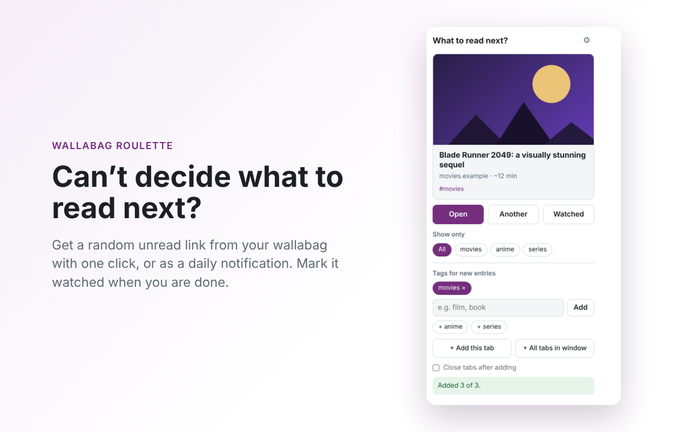
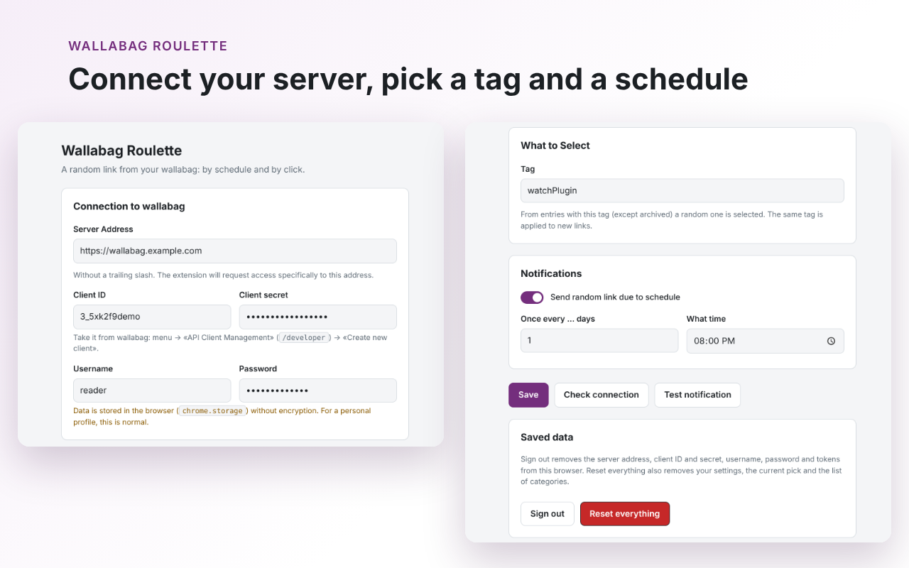

# Wallabag Roulette

A Chrome extension that picks a **random unread link from your own [wallabag](https://wallabag.org)** by tag, so you stop wondering what to read or watch next. It shows the pick in a popup or as a scheduled notification, and it also saves your open tabs to wallabag.

> Unofficial. Not affiliated with or endorsed by the wallabag project. You need your own wallabag instance (self-hosted or hosted).




## Features

- **Random pick in one click.** Open the popup and get a random unread entry with the chosen tag (title, domain, reading time, preview).
- **Scheduled notification.** A random pick every N days at the time you choose, with _Open_ and _Other_ buttons.
- **The current pick stays put.** The popup and the notification show the same entry until you press _Watched_. Only then is it archived in wallabag.
- **Categories.** Tag what you save (`movies`, `books`, `anime`, ...), choose from your existing wallabag tags, get a hint when a new tag looks like an existing one, and filter random picks by one category.
- **Fast saving.** Add the current tab or all tabs of the window from the popup, from the right-click menu (page, link, toolbar icon) or with a hotkey (`Ctrl+Shift+Y` by default). Adding runs in the background and retries when the network is down.
- **Light and dark themes**, including a toolbar icon that follows the browser theme.

## Setup

1. In wallabag open **menu → API clients management** (`/developer`) and create a new client.
2. Open the extension settings and enter the server address (without a trailing slash), client ID and secret, your username and password.
3. Set the tag that marks your reading/watch list and the notification schedule.
4. Press **Check connection**. The browser asks for access to your server address only.

## Install

**From the Chrome Web Store:** _link will appear here after publication._

**From source:**

1. Clone this repository.
2. Open `chrome://extensions` and turn on _Developer mode_.
3. Press _Load unpacked_ and select the repository folder (the one with `manifest.json`).

## Permissions

| Permission           | Why                                                                               |
| -------------------- | --------------------------------------------------------------------------------- |
| `storage`            | Settings, current pick, tag statistics and the add queue, all stored locally.     |
| `alarms`             | Schedules the notification and retries queued saves.                              |
| `notifications`      | Shows the scheduled random pick.                                                  |
| `tabs`               | Reads the URL and title of the tabs you choose to save and opens the picked link. |
| `contextMenus`       | Adds the "Add to wallabag" items to the right-click menu.                         |
| `offscreen`          | A hidden page that reads the browser color scheme to choose the toolbar icon.     |
| optional host access | Requested at runtime for **one** origin: the wallabag address you enter.          |

## Privacy

No analytics, no ads, no third-party servers. The extension talks only to the wallabag server you configured. Details: [PRIVACY.md](PRIVACY.md).

Your credentials are stored in `chrome.storage.local` without extra encryption. Use _Sign out_ or _Reset everything_ in the settings to remove them.

## Development

Plain JavaScript (ES modules), no build step.

```
manifest.json
src/
  html/        popup, options, offscreen pages
  css/
  js/
    background/   service worker: alarms, notifications, messages
    wallabag-api/ OAuth and API calls
    queue/        background add queue with retries
    scheduler/    notification schedule
    categories/   tags, statistics, similar-tag hints
    entry-state/  current pick, archive
    menu/         context menu and hotkey
    theme/        toolbar icon by browser theme
    account/      sign out / reset
  icons/
```

Reload the extension on `chrome://extensions` after changes.

## Issues

Bug reports and ideas are welcome in the [issue tracker](../../issues).

## License

MIT, see [LICENSE](LICENSE)
